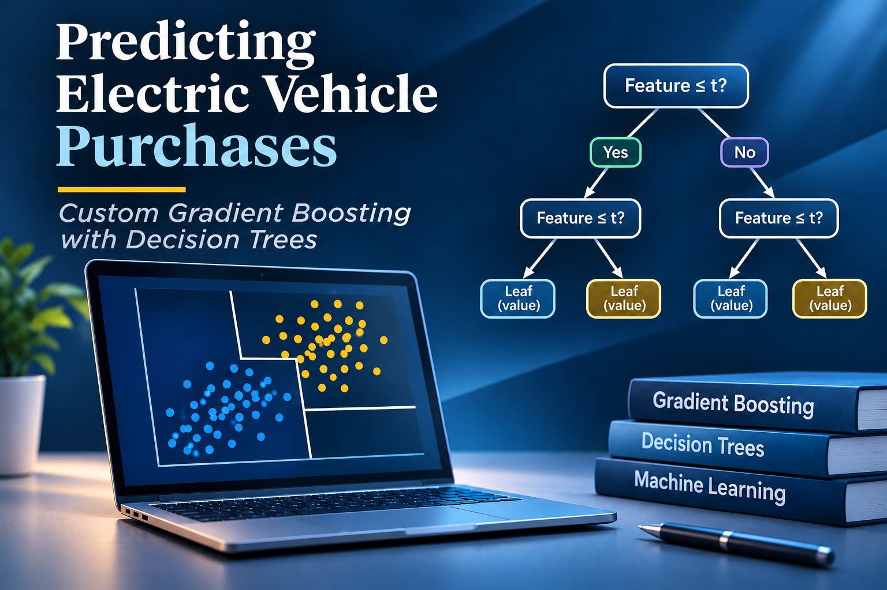

# Predicting Electric Vehicle Purchases

**0.93827 private ROC-AUC on Kaggle - with gradient boosting built from scratch using NumPy and pandas.**

Instead of importing a ready-made estimator, this competition entry implements regression trees, numerical and categorical split selection, boosting, early stopping, and ROC-AUC evaluation directly in Python.

  [](https://www.kaggle.com/code/lucalullo/predicting-electric-vehicle-purchases?scriptVersionId=354061061)

[Kaggle notebook](https://www.kaggle.com/code/lucalullo/predicting-electric-vehicle-purchases?scriptVersionId=354061061) · [GitHub repository](https://github.com/lucalullo/predicting-electric-vehicle-purchases)



## At a glance

| | |
|---|---|
| **Task** | Binary classification: electric vehicle purchase intent (`Will_Buy_EV`) |
| **Competition** | Kaggle Playground Series, Season 6 Episode 9 |
| **Private score** | **0.93827** (ROC-AUC) |
| **Submission** | Original Kaggle notebook, V1 |
| **Implementation** | Custom gradient boosting with shallow regression trees |
| **Core libraries** | NumPy and pandas; no pre-built ML estimator |
| **Validation** | Stratified holdout, custom AUC function, early stopping |
| **Data** | Competition-provided train/test CSVs (not redistributed here) |

## Project overview

This is an **algorithm-first machine learning experiment**: the emphasis is on understanding and implementing a model's internal mechanics, while still obtaining a competitive private leaderboard result.

The notebook covers:

- **Feature engineering:** interaction features involving environmental concern, subsidies, range anxiety and home charging, plus income-based features.
- **Tree learning:** custom numerical and categorical split searches, depth-limited regression trees and recursive prediction.
- **Boosting:** residual-based updates, a fixed learning rate and an ensemble of shallow trees.
- **Model selection:** stratified validation, ROC-AUC calculated from ranks, and early stopping.
- **Final submission:** retraining on the full labeled dataset and exporting a Kaggle-compatible `submission.csv`.

## Methodology

```text
Kaggle training data
        |
        v
Feature engineering
        |
        v
Stratified train/validation split
        |
        v
Custom regression trees + residual boosting
        |
        v
Validation ROC-AUC + early stopping
        |
        v
Retrain on all labeled rows
        |
        v
Predict competition test set
        |
        v
submission.csv
```

### Implementation details

| Component | Notebook implementation |
|---|---|
| Numerical splits | Sort values and search split positions using cumulative residual statistics |
| Categorical splits | Aggregate per-category residual statistics and select partitions |
| Base learners | Regression trees with maximum depth 2 and minimum leaf size 500 |
| Ensemble | Learning rate `0.03`, maximum `2,000` iterations, patience `60` |
| Selected ensemble | `977` trees in the captured notebook execution |
| Metric | Custom rank-based ROC-AUC |

The notebook is intentionally focused on a single experiment rather than a general-purpose ML library.

## Results

> **Private ROC-AUC: 0.93827 - Kaggle submission V1.**

This is the private leaderboard score reported for the original submission. It is **not** presented as a benchmark proving superiority over XGBoost, LightGBM or CatBoost; no such comparative benchmark is provided here.

[See the original Kaggle notebook and version](https://www.kaggle.com/code/lucalullo/predicting-electric-vehicle-purchases?scriptVersionId=354061061).

## Repository structure

```text
predicting-electric-vehicle-purchases/
├── README.md
├── cover.png
├── predicting-electric-vehicle-purchases.ipynb
├── requirements.txt
└── .gitignore
```

The `.ipynb` file is preserved **byte-for-byte from the supplied competition notebook**. No modeling logic, outputs, or notebook commentary has been revised for this GitHub release.

## Getting started

The reference environment is **Kaggle**: the original notebook expects competition input files in:

```text
/kaggle/input/competitions/playground-series-s6e9/
```

To run it locally, install the notebook dependencies:

```bash
python -m pip install -r requirements.txt
```

Then open `predicting-electric-vehicle-purchases.ipynb` in Jupyter and make the original Kaggle competition CSV files available. **Local execution requires updating the `PATH` constant inside the notebook** to match the location of those CSVs. That would be a local adjustment, not a change to the archived submission.

The full training pass was computationally intensive in the captured notebook run; the exact time depends on hardware and environment.

## Limitations

- This repository archives **the version used for the competition**. It is deliberately not a post-competition refactor.
- Some engineered thresholds were identified in earlier experiments, as disclosed in the notebook introduction.
- The final prediction values are **ranking scores, not calibrated probabilities**. The notebook output includes values outside the `[0, 1]` interval. This does not by itself invalidate rank-based ROC-AUC, but the scores should not be interpreted as probabilities.
- The notebook uses a single holdout validation, not cross-validation or a systematic comparison against established boosting libraries.
- The competition data are not included here. Availability and permitted use are governed by Kaggle and the relevant competition rules.

## Related work

This project complements my other work on applied machine learning, algorithms implemented from scratch, and reproducible data analysis.

- [GitHub profile and selected projects](https://github.com/lucalullo)
- [Kaggle profile](https://www.kaggle.com/lucalullo)

**Original competition work:** [Predicting Electric Vehicle Purchases - V1](https://www.kaggle.com/code/lucalullo/predicting-electric-vehicle-purchases?scriptVersionId=354061061)

## Author

Created by [Luca Lullo](https://github.com/lucalullo).
